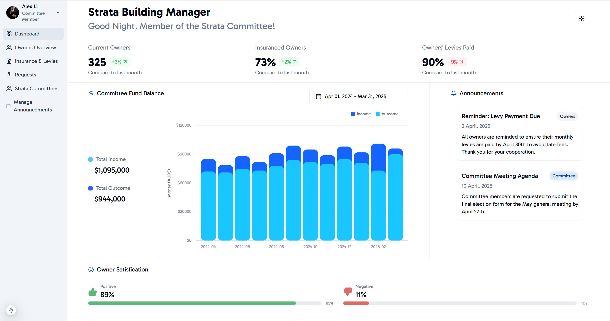
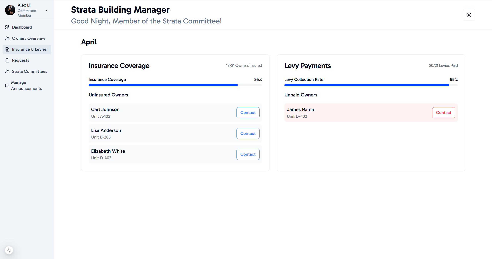

# Strata Building Manager

A management dashboard for a strata (apartment block) committee.
Deployed on Vercel:
https://visactor-nextjs-template-omega.vercel.app/

Built in 2025 as a self-directed learning project for INFO1111 at the University of Sydney. 
The brief was simply "teach yourself a technology and build something with it". At the start of it I
had never written TypeScript, PHP or SQL, and I started everything from scratch.



## What it does

| Page | What it shows |
| --- | --- |
| Dashboard | Owner count, insurance and levy rates, committee fund balance chart, latest announcements |
| Owners Overview | Every current owner, sorted by building then room |
| Insurance & Levies | Coverage and collection rates, plus exactly who is outstanding |
| Requests | All owner requests, with a form to file a new one |
| Strata Committees | Committee member profiles and a random strata fact on every load |
| Manage Announcements | All announcements, with a form to broadcast a new one |



## Architecture

```
Next.js 15 (App Router, TypeScript, Tailwind, shadcn/ui, VisActor charts)
        │
        ├── /api/greeting, /api/quotes      Edge functions (time zone aware greeting, random fact)
        ├── /api/requests                   Node route handler
        └── /api/*.php                      PHP serverless functions (vercel-php runtime)
                 │
                 └── api/data/*.json        Read-only seed data
```

Three runtimes in one Vercel deployment. The PHP functions are the interesting part: Vercel has no
first-party PHP support, so they run on the community [vercel-php](https://github.com/vercel-community/php)
runtime declared in `vercel.json`. Because every function is cold-started per request, nothing can
be held in memory between calls.

### API

| Endpoint | Methods | Notes |
| --- | --- | --- |
| `/api/owners.php` | GET | All owners, or one via `?id=`; 404 if absent |
| `/api/insurance.php` | GET | Aggregate coverage plus the uninsured and unpaid lists |
| `/api/announcements.php` | GET, POST | POST validates required fields and returns 201 |
| `/api/users.php` | GET | Committee members; passwords are never returned |
| `/api/login.php` | POST, HEAD | Sets a `Secure`/`HttpOnly`/`SameSite=Lax` session cookie |
| `/api/logout.php` | POST | Clears the session and the cookie |

Endpoints return 200, 201, 400, 404, 405 and 500 as appropriate, handle `OPTIONS` preflight, and
restrict CORS to known origins.

## Running it locally

```bash
pnpm install
pnpm dev                       
php -S 127.0.0.1:8000         
```

Sign in as `Alex Li`, `John Strata` or `Carl Johnson` with the password `Strata`.

## A note on the database

This app originally ran against a **MySQL database hosted on Railway**, reached through a
`DATABASE_URL` environment variable set in Vercel. The PHP functions queried four tables — `owners`,
`users`, `announcements` and `requests` — using prepared statements (`prepare()` / `bind_param()`)
so that user-submitted announcement text could not be used for SQL injection.

That Railway instance is no longer running, so the project now ships the same seed data as JSON in
`api/data/` and serves it read-only. The endpoints keep their original URLs, query parameters and
response shapes, and the old SQL is left inline as comments next to the code that replaced it. One
consequence is that submitting an announcement or request will be kept only for your browser session rather than written to storage.

## What I learned building this

Roughly in order, and all of it from scratch:

- **Vercel and Next.js**
- **Serverless vs. edge functions**
- **PHP, sessions and cookies**
- **MySQL**

## Credits

The website was started from the
[VisActor Next.js template](https://github.com/mengxi-ream/visactor-next-template) (MIT).

